# Capto

[English](README.md) · **Français**

Capto est un outil de capture d'écran pour Windows 10 et 11 : capturez une zone, une fenêtre ou un écran depuis n'importe quelle application, annotez-la, puis collez-la, enregistrez-la ou retrouvez-la plus tard dans l'historique. Il enregistre aussi l'écran en vidéo, avec le son, que vous pouvez couper ou transformer en GIF animé.

- **À une touche de distance.** Les raccourcis fonctionnent depuis n'importe quelle application ; Capto attend dans la zone de notification.
- **Prêt à coller.** Par défaut, chaque capture est dans le presse-papiers dès qu'elle est prise.
- **Rien ne se perd.** Chaque capture et chaque vidéo sont gardées dans un historique avec recherche, annotations comprises.
- **Tout reste sur votre PC.** Pas de compte, pas de cloud, pas de télémétrie. Le seul accès réseau est la recherche de mises à jour sur ce dépôt.

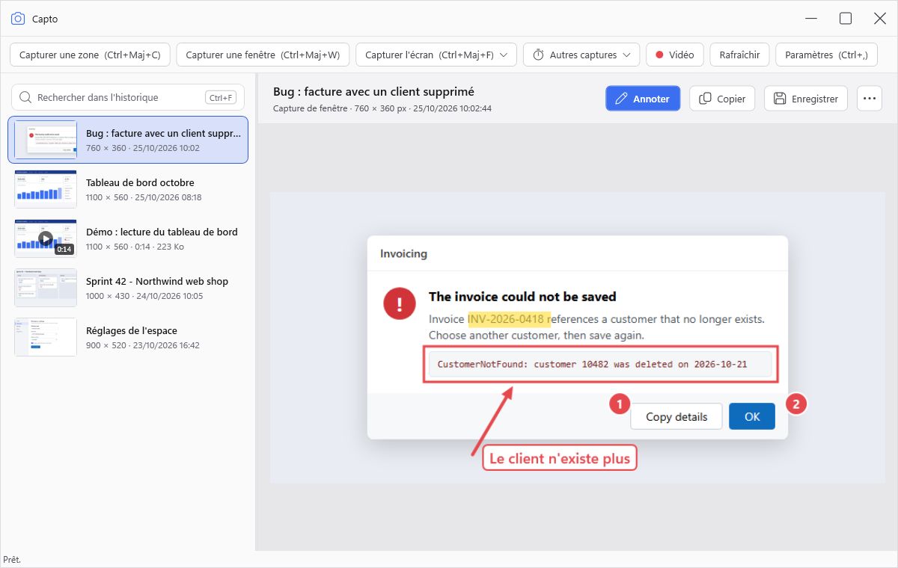

Ce dépôt contient les installeurs, les paquets de mise à jour et les notes de version de Capto. Le code source n'est pas public.

## Sommaire

- [Installation](#installation)
- [Prise en main](#prise-en-main)
- [Capturer](#capturer)
- [Enregistrer une vidéo](#enregistrer-une-vidéo)
- [L'historique](#lhistorique)
- [L'éditeur d'annotations](#léditeur-dannotations)
- [Couper une vidéo et exporter un GIF](#couper-une-vidéo-et-exporter-un-gif)
- [Paramètres](#paramètres)
- [Raccourcis clavier](#raccourcis-clavier)
- [Mises à jour](#mises-à-jour)
- [Où sont vos données](#où-sont-vos-données)
- [Désinstallation](#désinstallation)
- [Dépannage](#dépannage)

## Installation

1. Téléchargez `Capto-win-Setup.exe` depuis la [dernière version](https://github.com/gaetanthouvenin/Capto-releases/releases/latest).
2. Lancez-le. L'installeur n'est pas encore signé : Windows SmartScreen signale un « éditeur inconnu ». Cliquez sur **Informations complémentaires**, puis **Exécuter quand même**.
3. Capto s'installe pour l'utilisateur courant uniquement (pas besoin de droits administrateur), dans `%LocalAppData%\CaptoApp`, ajoute un raccourci au menu Démarrer et se lance.

`Capto-win-Portable.zip` est la même application sans installation : décompressez-la où vous voulez et lancez `Capto.exe`.

## Prise en main

Capto ouvre sa fenêtre principale : une barre avec les boutons de capture, l'historique à gauche et la capture sélectionnée à droite. Son icône apparaît aussi dans la zone de notification, près de l'horloge ; un clic droit dessus donne les commandes de capture, les paramètres et **Quitter**.

Le plus rapide :

1. Appuyez sur **Ctrl+Maj+C** depuis n'importe quelle application.
2. Faites glisser la souris sur la partie de l'écran voulue.
3. Collez (**Ctrl+V**) dans votre messagerie, votre e-mail ou votre document.

Fermer la fenêtre principale laisse Capto tourner dans la zone de notification (réglable dans les paramètres) : les raccourcis restent disponibles. Activez **Démarrer avec Windows** dans les paramètres pour que Capto soit prêt à chaque ouverture de session.

## Capturer

| Capture | Raccourci | Ce qu'elle fait |
|---|---|---|
| Zone | Ctrl+Maj+C | Tracez un rectangle sur l'écran. |
| Fenêtre | Ctrl+Maj+W | Survolez une fenêtre et cliquez dessus. |
| Écran | Ctrl+Maj+F | Capture l'écran sous le pointeur de la souris. |
| Tous les écrans | Ctrl+Maj+Alt+F | Capture tous les moniteurs dans une seule image. |
| Répéter la dernière zone | Ctrl+Maj+Alt+C | Capture le même rectangle que la dernière capture de zone, sans le resélectionner. |
| Zone différée | Ctrl+Maj+D | Attend quelques secondes, puis ouvre la sélection de zone. |

Les mêmes commandes sont dans la barre de la fenêtre principale (les moins courantes sous **Autres captures**) et dans le menu de l'icône de la zone de notification.

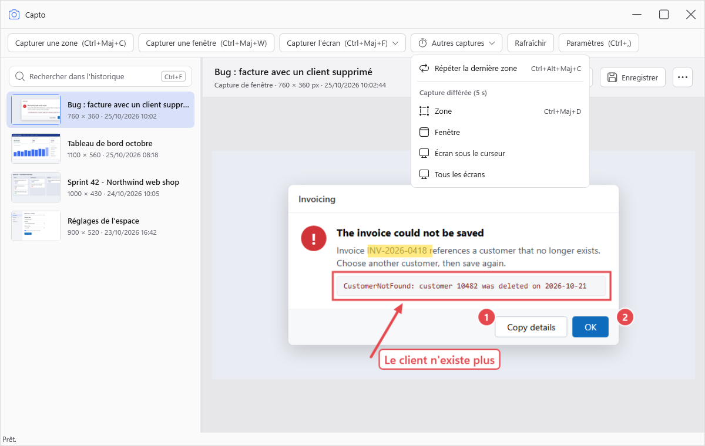

### Sélectionner une zone ou une fenêtre

Au lancement d'une capture de zone ou de fenêtre, l'écran se fige : ce que vous sélectionnez est exactement ce qui était affiché au moment du raccourci, même si un menu ou une infobulle se ferme entre-temps.

- **Zone :** faites glisser la souris pour tracer le rectangle ; sa taille en pixels s'affiche à côté.
- **Fenêtre :** survolez une fenêtre pour la mettre en évidence, puis cliquez. **Tab** passe à la fenêtre suivante, pratique pour les fenêtres cachées derrière d'autres. La fenêtre est capturée seule, même là où d'autres fenêtres la recouvrent.
- **W** passe en sélection de fenêtre, **R** revient à la sélection de zone.
- **Échap** annule.

La barre en haut de l'écran rappelle le mode et les touches ; la taille du rectangle s'affiche à son coin.

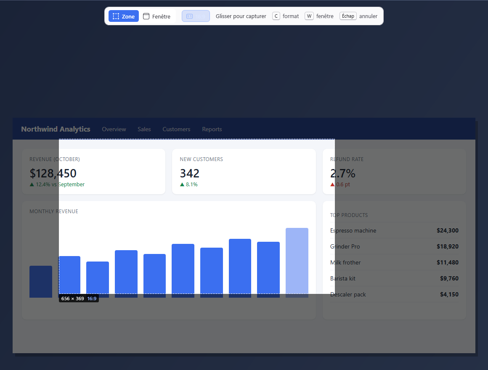

### Formats de zone

La sélection de zone peut suivre un format au lieu d'un rectangle libre :

- **Proportions** (16:9, 4:3, 1:1) : le rectangle garde ses proportions pendant que vous le tracez.
- **Tailles fixes** (1280 × 720, 1920 × 1080, 800 × 600) : un cadre de cette taille suit la souris ; cliquez pour le poser.

Pendant la sélection, **C** fait défiler les formats, **1** à **9** en choisissent un directement et **0** revient à **Libre**. Capto retient le dernier format utilisé. Vous pouvez ajouter jusqu'à 8 formats personnels dans **Paramètres › Formats de zone**.

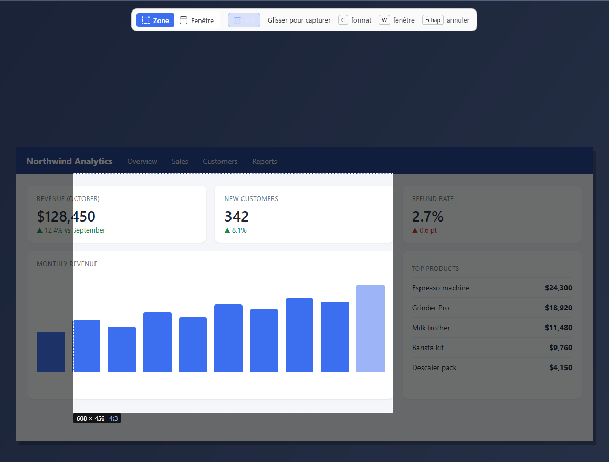

### Capture différée

Une capture différée affiche un petit compte à rebours dans un coin de l'écran (3, 5 ou 10 secondes, 5 par défaut ; il n'apparaît jamais dans l'image) avant de capturer, ce qui laisse le temps d'ouvrir un menu ou de survoler un élément. **Échap** annule le compte à rebours. Les entrées différées sont sous **Autres captures** dans la fenêtre principale et sous **Capture différée** dans le menu de l'icône ; le délai se règle dans **Paramètres › Capture**.

### Après une capture

Par défaut, la capture est copiée dans le presse-papiers et ajoutée à l'historique. Selon les paramètres, Capto peut aussi jouer un son, ouvrir l'éditeur, afficher une notification (seulement quand la fenêtre principale est masquée) et dessiner le pointeur de la souris dans l'image.

## Enregistrer une vidéo

Capto enregistre une zone, une fenêtre ou un écran entier dans une vidéo MP4 (H.264), avec le son de l'ordinateur et, si vous le voulez, votre microphone.

1. Appuyez sur **Ctrl+Maj+Alt+R**, cliquez sur **Vidéo** dans la barre de la fenêtre principale, ou choisissez **Enregistrer une vidéo** dans le menu de l'icône.
2. Choisissez quoi enregistrer, comme pour une capture : tracez une zone, cliquez sur une fenêtre, ou appuyez sur **S** et cliquez sur un écran. **W** et **R** passent en sélection de fenêtre et de zone, et les formats de zone fonctionnent aussi.
3. Un compte à rebours de 3 secondes démarre, puis l'enregistrement.
4. Appuyez de nouveau sur **Ctrl+Maj+Alt+R**, ou cliquez sur **Arrêter** dans la barre d'enregistrement : la vidéo est ajoutée à l'historique.

Pendant la sélection, les pastilles en haut de l'écran indiquent les sons qui seront enregistrés : **A** active ou coupe le son système, **M** le microphone, pour cet enregistrement seulement.

Pendant l'enregistrement, une petite barre affiche le temps écoulé, avec **Suspendre** / **Reprendre**, **Arrêter**, un bouton pour abandonner l'enregistrement, et un bouton pour couper chaque source de son avec son vumètre. Déplacez-la par sa poignée. Ni la barre ni le cadre autour de la zone enregistrée n'apparaissent dans la vidéo. Les mêmes commandes sont dans le menu de l'icône.

- Une vidéo de fenêtre suit la fenêtre quand vous la déplacez, mais les menus et les infobulles n'y apparaissent pas : enregistrez une zone pour les montrer.
- L'enregistrement s'arrête seul, en gardant la vidéo, quand il atteint la durée maximale (60 minutes par défaut), quand la fenêtre enregistrée se ferme ou quand le disque est presque plein.
- Si Capto ou Windows s'arrête pendant un enregistrement, la vidéo est récupérée au démarrage suivant.
- L'enregistrement vidéo demande Windows 10 version 2004 ou plus récent. Sur une édition N de Windows, installez d'abord le Media Feature Pack.

## L'historique

Chaque capture et chaque vidéo sont gardées dans l'historique de la fenêtre principale, la plus récente en haut. Sélectionnez une vidéo pour la lire dans le panneau de détail (**Espace** lance et met en pause) ; ses détails indiquent sa durée, sa taille et les sons enregistrés.

- **Rechercher** (**Ctrl+F**) par nom, titre de fenêtre ou date.
- **Copier** (**Ctrl+C**) remet la capture, avec ses annotations, dans le presse-papiers. Pour une vidéo, il copie le fichier, prêt à coller dans un dossier ou une conversation.
- **Enregistrer** (**Ctrl+S**) l'écrit dans le dossier d'export par défaut, **Enregistrer sous** (**Ctrl+Maj+S**) demande où ; en PNG ou JPEG pour une capture, en MP4 pour une vidéo.
- **Faites glisser** une capture de l'historique vers une autre application (un e-mail, une messagerie, un dossier) pour y déposer l'image.
- **Annoter** (**Entrée**) ouvre l'éditeur.
- **Renommer** (**F2**) donne à la capture un nom que la recherche retrouve.
- **Ouvrir le fichier** et **Afficher dans le dossier** donnent accès au fichier image.
- **Supprimer** (**Suppr**) envoie la capture dans la Corbeille de Windows, d'où elle peut être restaurée. Plusieurs captures peuvent être sélectionnées et supprimées d'un coup.

L'historique peut se nettoyer tout seul : dans **Paramètres › Stockage**, indiquez combien de jours garder les captures et combien en garder au maximum (0 = sans limite). Les plus anciennes partent à la Corbeille. Les vidéos ont leur propre limite, une taille totale réglée dans **Paramètres › Enregistrement** (20 Go par défaut).

## L'éditeur d'annotations

Ouvrez-le avec **Annoter** (ou **Entrée**) sur une capture, ou automatiquement après chaque capture en activant **Ouvrir l'éditeur après la capture**.

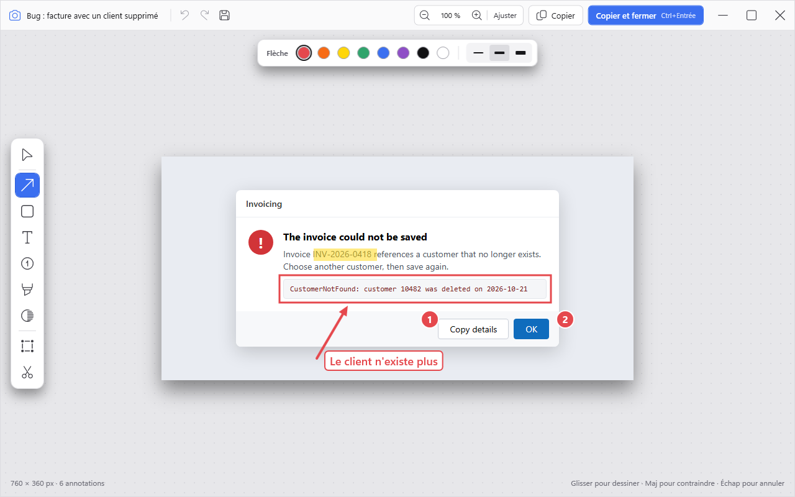

| Outil | Touche | Usage |
|---|---|---|
| Sélection | V | Sélectionner, déplacer, redimensionner, dupliquer (Ctrl+D) ou supprimer (Suppr) une annotation. |
| Flèche | A | Pointer quelque chose. |
| Rectangle | R | Encadrer une zone, avec ou sans remplissage. |
| Texte | T | Écrire une note, éventuellement dans un cadre qui reste lisible sur une image chargée. |
| Numéro | N | Poser des pastilles numérotées (1, 2, 3…) pour des instructions pas à pas ; en supprimer une renumérote les autres. |
| Surligneur | H | Surligner du texte comme au feutre. |
| Flou | B | Masquer un mot de passe, un nom ou un e-mail en pixelisant ou en floutant une zone. |
| Recadrer | C | Ne garder qu'une partie de l'image. |
| Découpe | X | Retirer une bande horizontale ou verticale et recoller les deux bords (droit, zigzag ou déchiré), par exemple pour raccourcir une longue page. |

- La couleur, l'épaisseur et la taille sont dans la barre de propriétés de l'outil choisi. Maintenez **Maj** en dessinant pour contraindre la forme (flèches droites, carrés).
- **Ctrl+Z** / **Ctrl+Y** annulent et rétablissent, **Ctrl+S** enregistre les annotations, **Ctrl+C** copie l'image annotée, **Ctrl+Entrée** enregistre, copie et ferme l'éditeur.
- Zoomez avec **Ctrl+-** / **Ctrl++**, **Ctrl+0** ajuste l'image à la fenêtre, **Ctrl+1** l'affiche en taille réelle.
- Les annotations restent modifiables : l'image d'origine n'est jamais modifiée, et le recadrage comme la découpe peuvent être annulés à tout moment. Les copies, les fichiers enregistrés et les glisser-déposer contiennent toujours l'image annotée, avec le flou appliqué définitivement.

## Couper une vidéo et exporter un GIF

Sélectionnez une vidéo dans l'historique, puis cliquez sur **Couper** pour n'en garder qu'une partie. Une frise d'images montre la vidéo, avec une poignée pour le début et une pour la fin de l'extrait.

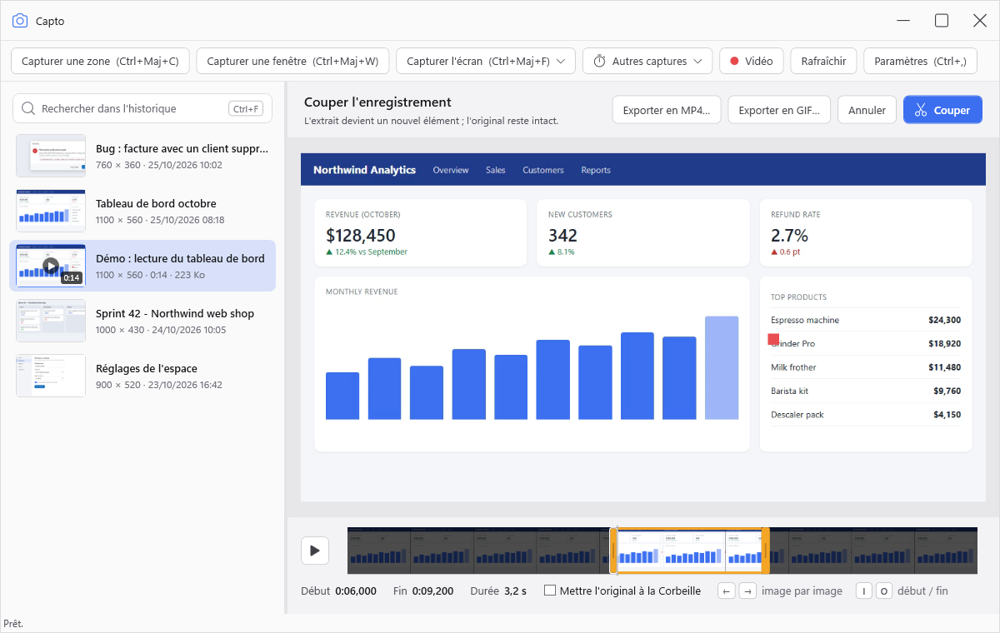

- Faites glisser les poignées, ou avancez image par image avec **←** / **→** (**Maj** saute d'une seconde) et placez le début et la fin sur l'image courante avec **I** / **O**. **Origine** / **Fin** vont au début et à la fin.
- **Espace** lit l'extrait. En pause, l'image affichée est exactement celle où passera la coupe.
- **Couper** (**Entrée**) crée l'extrait comme un nouvel élément de l'historique, coupé à l'image près, avec son son. L'original reste intact, sauf si vous cochez **Mettre l'original à la Corbeille**.
- **Exporter en MP4…** demande où enregistrer l'extrait dans un fichier, sans l'ajouter à l'historique. **Échap** quitte sans couper.

**Exporter en GIF**, sur une vidéo ou depuis le mode coupe pour l'extrait choisi, crée un GIF animé : 10, 15 ou 20 images par seconde (15 par défaut), une largeur de 640, 800 (par défaut) ou 1280 pixels ou la taille originale, une palette par image ou globale, la lecture en boucle et le tramage. La taille estimée se met à jour quand vous changez les options. **Copier aussi le fichier** met le GIF dans le presse-papiers, pour le coller dans Teams, Slack ou Outlook. **Exporter** l'écrit dans le dossier d'export par défaut, **Enregistrer sous…** demande où. Un GIF dure au plus 60 secondes : pour une vidéo plus longue, Capto ouvre le mode coupe sur sa première minute pour que vous choisissiez l'extrait.

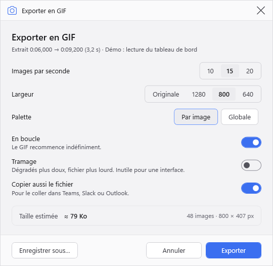

## Paramètres

Ouvrez-les avec **Ctrl+,** dans la fenêtre principale ou depuis le menu de l'icône. Les changements s'appliquent quand vous cliquez sur **Enregistrer**.

### Général

Démarrer avec Windows, démarrer réduit, fermer dans la zone de notification, notification après une capture, recherche des mises à jour, thème (système, clair ou sombre) et langue. Capto suit la langue de Windows par défaut et existe en français, anglais, allemand, espagnol, italien, portugais, néerlandais, chinois, japonais et coréen ; un changement de langue s'applique au prochain démarrage.

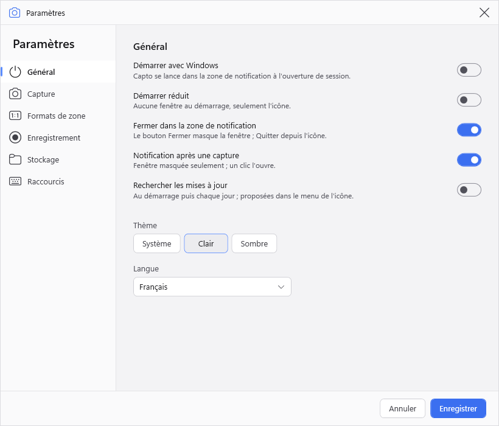

### Capture

Copier dans le presse-papiers, copier aussi le fichier (pratique pour les pièces jointes Outlook), ouvrir l'éditeur après la capture, jouer un son, inclure le curseur, délai des captures différées, et le moteur de capture : Capto utilise Windows Graphics Capture, qui capture aussi les fenêtres masquées ; **Utiliser le moteur de capture GDI** revient à l'ancien moteur, à essayer si des captures sont noires ou incomplètes. **À propos de Capto** indique le moteur utilisé.

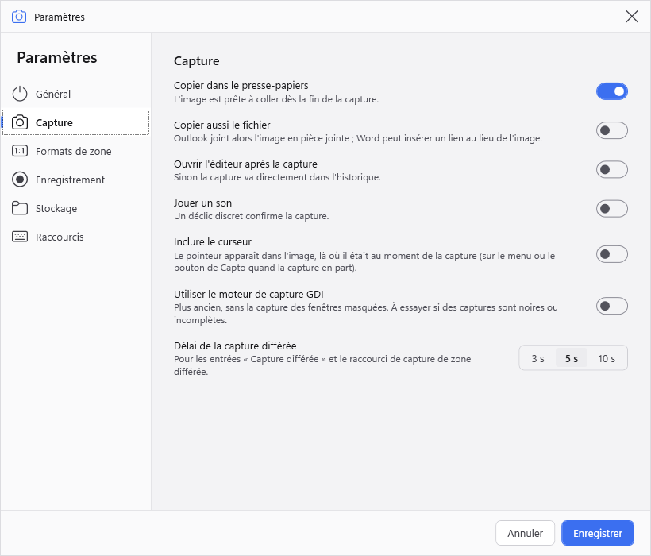

### Formats de zone

Les formats intégrés, avec la touche chiffrée qui choisit chacun pendant une sélection, et jusqu'à 8 proportions ou tailles fixes personnelles.

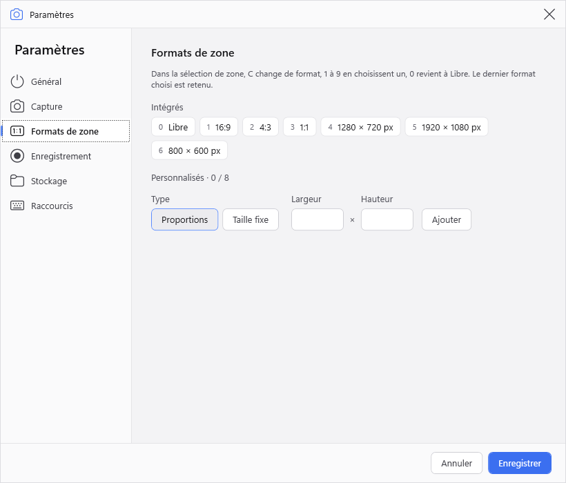

### Enregistrement

Images par seconde (15, 30 ou 60 ; 30 par défaut), qualité (basse, standard ou haute), inclure le curseur, mettre en évidence les clics par un anneau jaune, compte à rebours de 3 secondes, durée maximale (60 minutes par défaut), taille maximale totale des vidéos (20 Go par défaut ; au-delà, les plus anciennes partent à la Corbeille) et dossier des vidéos. La page indique aussi si un encodeur matériel (GPU) est disponible ; sans lui, l'encodage logiciel peut manquer des images en haute résolution.

**Son :** le son système (ce que joue l'ordinateur) est enregistré par défaut ; le microphone est désactivé par défaut et n'est ouvert que pendant un enregistrement. Choisissez les périphériques de sortie et d'entrée (celui de Windows par défaut, sauf si vous en choisissez un) et le gain de chaque source. Avec des haut-parleurs, le micro capte aussi le son système : préférez un casque.

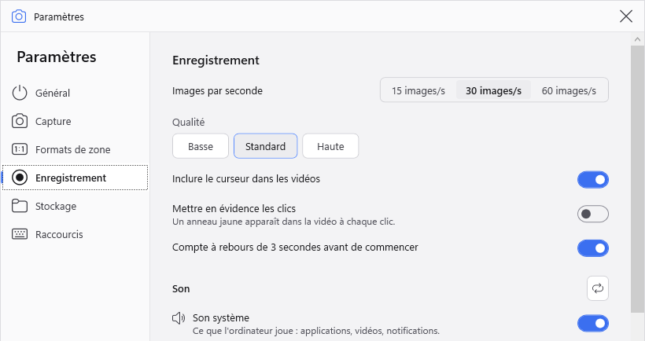

### Stockage

Dossier de l'historique, durée de conservation, dossier d'export par défaut, modèle de nom de fichier, format (PNG ou JPEG) et qualité JPEG. Le modèle de nom accepte `{date}`, `{time}`, `{kind}`, `{width}`, `{height}` et `{index}` ; par défaut, `Capto_{date}_{time}`.

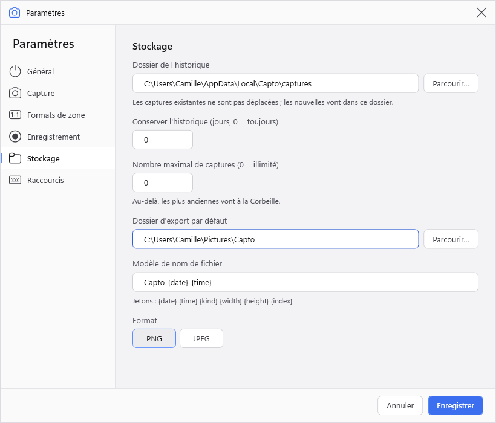

### Raccourcis

Cliquez sur un raccourci, puis appuyez sur la nouvelle combinaison ; **Retour arrière** efface les raccourcis facultatifs (zone différée, répéter la dernière zone, suspendre un enregistrement).

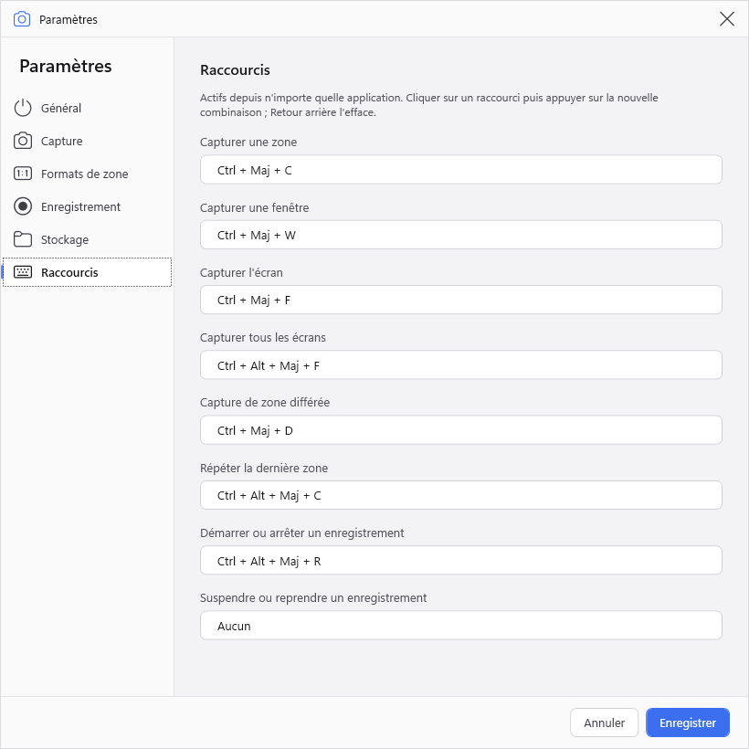

## Raccourcis clavier

**Depuis n'importe quelle application** (modifiables dans les paramètres ; **Suspendre les raccourcis**, dans le menu de l'icône, les coupe temporairement, par exemple quand une autre application a besoin des mêmes touches) :

| Raccourci | Action |
|---|---|
| Ctrl+Maj+C | Capturer une zone |
| Ctrl+Maj+W | Capturer une fenêtre |
| Ctrl+Maj+F | Capturer l'écran sous le pointeur |
| Ctrl+Maj+Alt+F | Capturer tous les écrans |
| Ctrl+Maj+Alt+C | Répéter la dernière zone |
| Ctrl+Maj+D | Capture de zone différée |
| Ctrl+Maj+Alt+R | Démarrer ou arrêter un enregistrement |
| (aucun par défaut) | Suspendre ou reprendre un enregistrement |

**Pendant une sélection :** Échap annule, W / R passent de la fenêtre à la zone, Tab passe à la fenêtre suivante, C change de format de zone, 0 à 9 choisissent un format. Pour une vidéo, aussi S pour un écran entier, A pour le son système et M pour le microphone.

**Dans la fenêtre principale :** Ctrl+F rechercher, Ctrl+C copier, Ctrl+S enregistrer, Ctrl+Maj+S enregistrer sous, Entrée annoter, F2 renommer, Suppr supprimer, Ctrl+, paramètres. Sur une vidéo, Espace lance et met en pause.

**Dans l'éditeur :** V A R T N H B C X pour les outils, Ctrl+Z annuler, Ctrl+Y rétablir, Ctrl+S enregistrer, Ctrl+C copier, Ctrl+Entrée copier et fermer, Ctrl+D dupliquer, Suppr supprimer, Ctrl+0 ajuster, Ctrl+1 taille réelle.

**Pour couper une vidéo :** ← / → une image (Maj : une seconde), I / O placent le début / la fin, Origine / Fin vont au début / à la fin, Espace lit l'extrait, Entrée coupe, Échap quitte.

## Mises à jour

La version installée vérifie ce dépôt au démarrage, puis une fois par jour (désactivable dans **Paramètres › Général**). Quand une nouvelle version est disponible, **Mettre à jour vers x.y.z** apparaît dans le menu de l'icône de la zone de notification : cliquez dessus, Capto télécharge la mise à jour et redémarre. Seules les versions stables sont proposées, jamais les préversions. **À propos de Capto**, dans le même menu, affiche la version installée.

Les changements de chaque version sont listés dans ses [notes de version](https://github.com/gaetanthouvenin/Capto-releases/releases).

## Où sont vos données

| Quoi | Où |
|---|---|
| Captures et annotations | `%LocalAppData%\Capto\captures` (modifiable dans **Paramètres › Stockage**) |
| Vidéos | le dossier `recordings` dans le dossier des captures |
| Paramètres | `%AppData%\Capto\settings.json` |
| Dernière zone et autres états propres à ce PC | `%LocalAppData%\Capto\state.json` |
| Images enregistrées et exportées | `Images\Capto` par défaut |
| L'application elle-même | `%LocalAppData%\CaptoApp` |

## Désinstallation

Désinstallez Capto depuis **Paramètres Windows › Applications › Applications installées**. Vos captures et vos paramètres sont conservés, une réinstallation les retrouve ; supprimez les dossiers `%LocalAppData%\Capto` et `%AppData%\Capto` pour les effacer aussi.

## Dépannage

- **Un raccourci ne fait rien :** une autre application l'utilise déjà, et Capto le signale dans sa barre d'état au démarrage. Choisissez une autre combinaison dans **Paramètres › Raccourcis**.
- **La capture n'est pas dans le presse-papiers :** vérifiez **Copier dans le presse-papiers** dans **Paramètres › Capture** ; la capture est de toute façon dans l'historique.
- **Word insère un lien au lieu de l'image :** désactivez **Copier aussi le fichier** dans **Paramètres › Capture**.
- **Une capture est noire ou incomplète :** activez **Utiliser le moteur de capture GDI** dans **Paramètres › Capture**.
- **Aucun encodeur vidéo H.264 n'est disponible :** sur une édition N de Windows, installez le Media Feature Pack depuis **Paramètres Windows › Applications › Fonctionnalités facultatives**.
- **Windows bloque le microphone :** autorisez les applications de bureau à utiliser le microphone dans **Paramètres Windows › Confidentialité et sécurité › Microphone** ; Capto propose d'ouvrir cette page, ou d'enregistrer sans le microphone.
- **Le micro sonne comme un appel téléphonique :** un casque Bluetooth passe en qualité téléphone quand son micro est utilisé ; prenez un micro filaire ou enregistrez sans.

---

Les versions sont publiées automatiquement par le workflow de release du dépôt source. Ce README, sa traduction et leurs images sont les seuls fichiers maintenus à la main.
