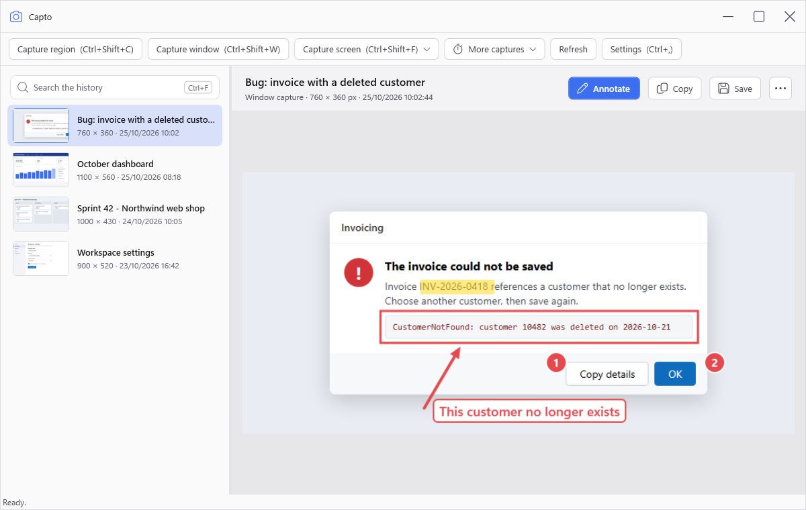
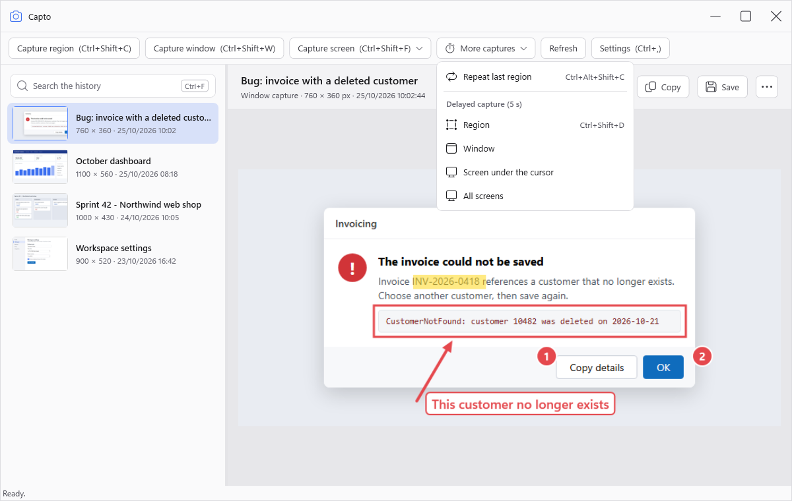
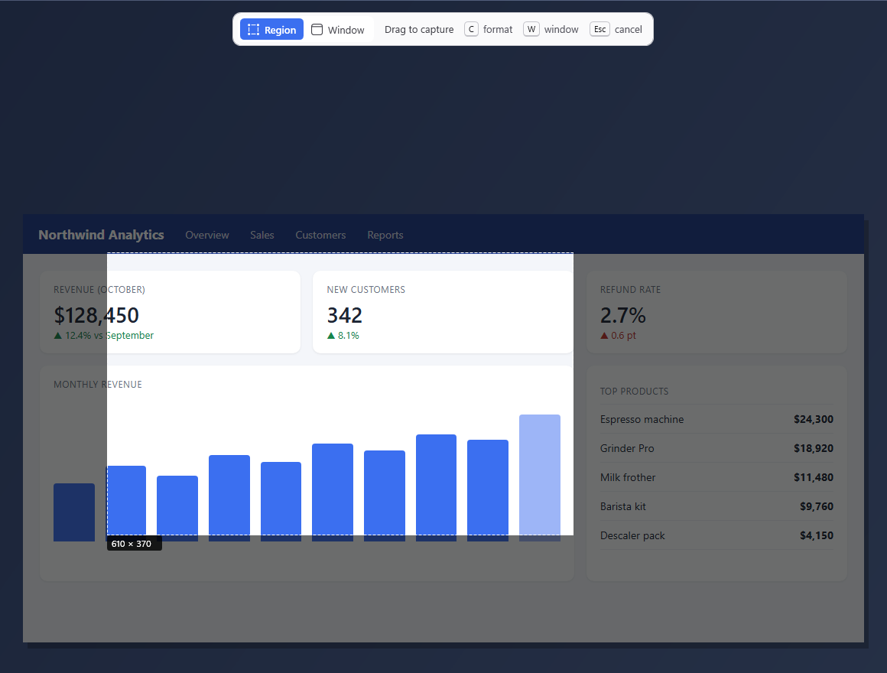
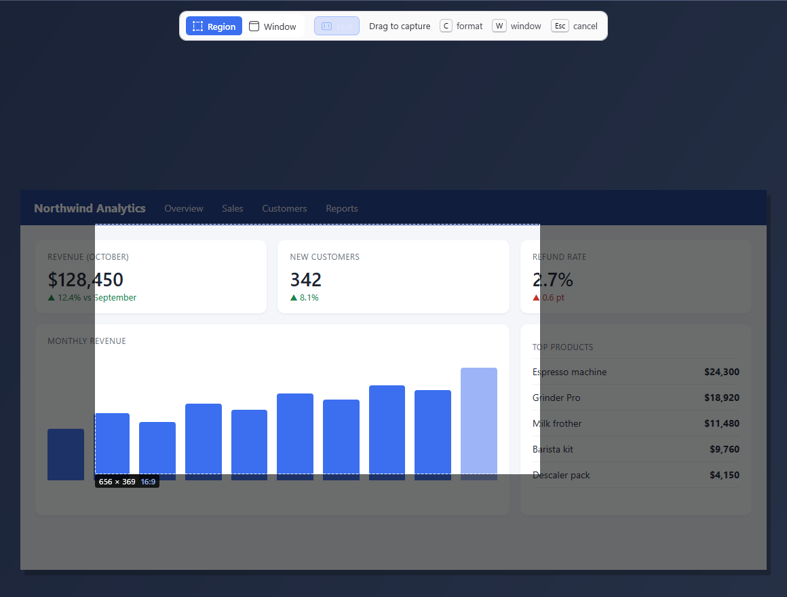
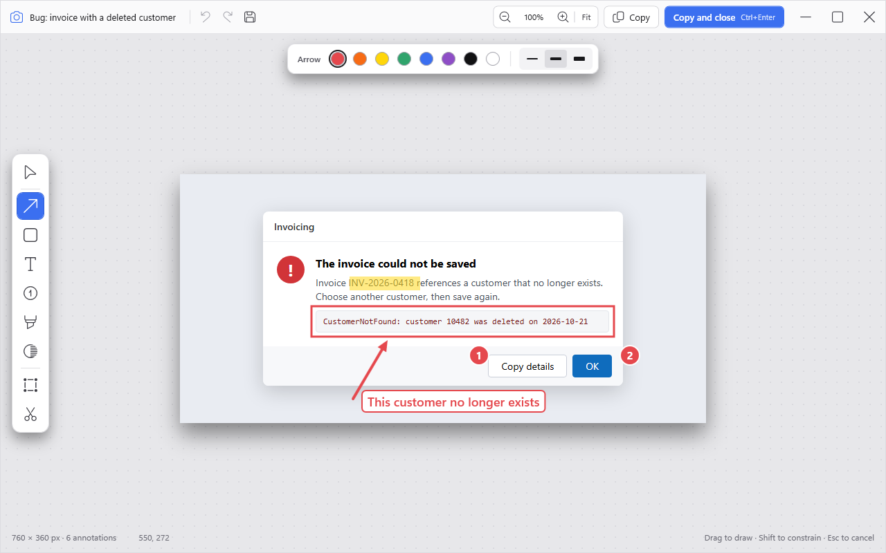
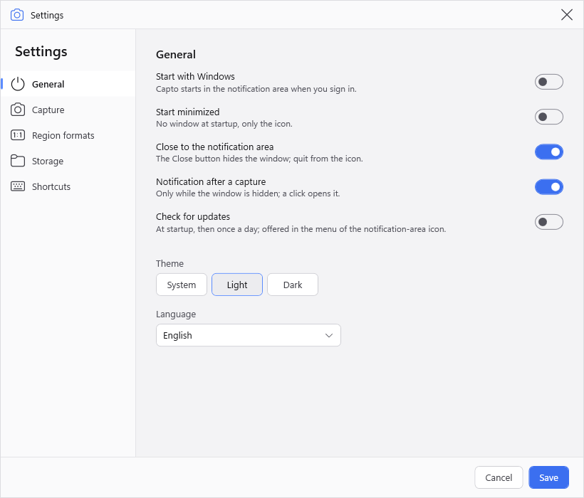
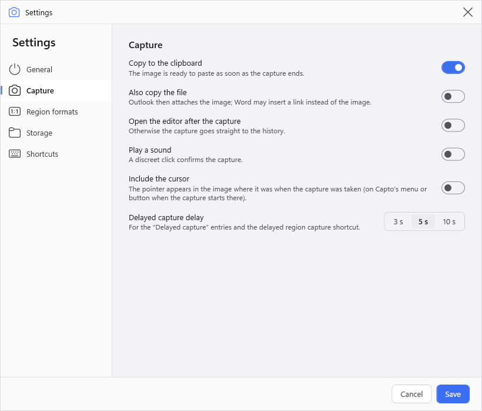
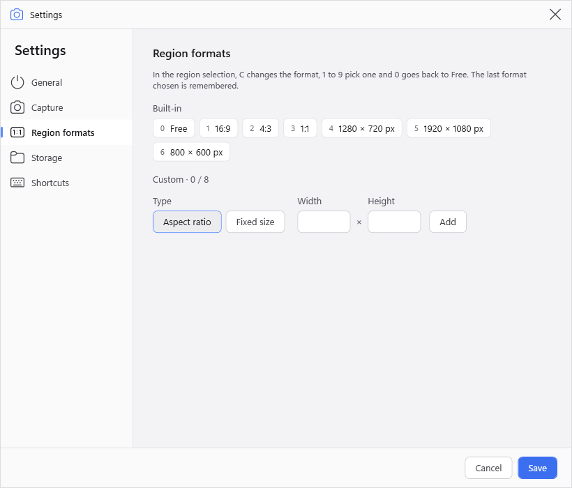
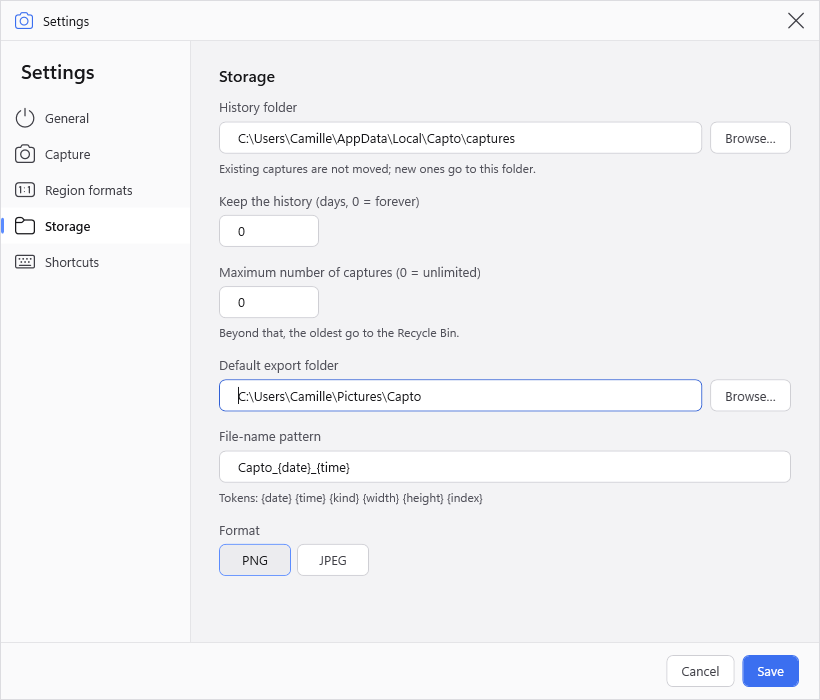
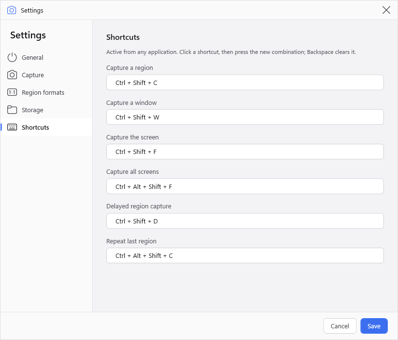

# Capto

**English** · [Français](README.fr.md)

Capto is a screen-capture tool for Windows 10 and 11: grab a region, a window or a screen from any application, annotate it, then paste, save or find it again later in the history.

- **One keystroke away.** Global shortcuts work from any application; Capto waits in the notification area.
- **Paste right away.** By default, every capture is in the clipboard as soon as it is taken.
- **Nothing is lost.** Every capture is kept in a searchable history, with its annotations.
- **Everything stays on your PC.** No account, no cloud, no telemetry. The only network access is the update check against this repository.

This repository holds the installers, the update packages and the release notes of Capto. The source code is not public.

## Contents

- [Install](#install)
- [Getting started](#getting-started)
- [Capturing](#capturing)
- [The history](#the-history)
- [The annotation editor](#the-annotation-editor)
- [Settings](#settings)
- [Keyboard shortcuts](#keyboard-shortcuts)
- [Updates](#updates)
- [Where your data is](#where-your-data-is)
- [Uninstall](#uninstall)
- [Troubleshooting](#troubleshooting)

## Install

1. Download `Capto-win-Setup.exe` from the [latest release](https://github.com/gaetanthouvenin/Capto-releases/releases/latest).
2. Run it. The installer is not signed yet, so Windows SmartScreen warns about an "unknown publisher": click **More info**, then **Run anyway**.
3. Capto installs for the current user only (no administrator rights needed), under `%LocalAppData%\CaptoApp`, adds a Start menu shortcut and starts.

`Capto-win-Portable.zip` is the same application without installation: unzip it anywhere and run `Capto.exe`.

## Getting started

Capto opens its main window: a toolbar with the capture buttons, the history on the left and the selected capture on the right. Its icon also appears in the notification area, next to the clock; right-click it for the capture commands, the settings and **Quit**.

The quickest way to use it:

1. Press **Ctrl+Shift+C** from any application.
2. Drag over the part of the screen you want.
3. Paste (**Ctrl+V**) in your chat, email or document.

Closing the main window keeps Capto running in the notification area (this can be changed in the settings), so the shortcuts stay available. Turn on **Start with Windows** in the settings to have Capto ready after every sign-in.

## Capturing

| Capture | Shortcut | What it does |
|---|---|---|
| Region | Ctrl+Shift+C | Drag a rectangle over the screen. |
| Window | Ctrl+Shift+W | Hover a window and click it. |
| Screen | Ctrl+Shift+F | Captures the screen under the mouse pointer. |
| All screens | Ctrl+Shift+Alt+F | Captures every monitor in one image. |
| Repeat last region | Ctrl+Shift+Alt+C | Captures the same rectangle as the last region capture, without selecting it again. |
| Delayed region | Ctrl+Shift+D | Waits a few seconds, then opens the region selection. |

The same commands are in the toolbar of the main window (the less common ones under **More captures**) and in the menu of the notification-area icon.

### Selecting a region or a window

When you start a region or window capture, the screen freezes: what you select is exactly what was on screen when you pressed the shortcut, even if a menu or a tooltip closes in the meantime.

- **Region:** drag to draw the rectangle; its size in pixels is shown next to it.
- **Window:** hover a window to highlight it, then click. **Tab** moves to the next window, which helps with windows hidden behind others.
- **W** switches to window selection, **R** back to region selection.
- **Esc** cancels.

The bar at the top of the screen recalls the mode and the keys; the size of the rectangle is shown at its corner.

### Region formats

The region selection can follow a format instead of a free rectangle:

- **Aspect ratios** (16:9, 4:3, 1:1): the rectangle keeps its proportions while you drag.
- **Fixed sizes** (1280 × 720, 1920 × 1080, 800 × 600): a frame of that size follows the mouse; click to place it.

In the region selection, **C** cycles through the formats, **1** to **9** pick one directly and **0** goes back to **Free**. Capto remembers the last format you used. You can add up to 8 formats of your own in **Settings › Region formats**.

### Delayed capture

A delayed capture shows a small countdown in a corner of the screen (3, 5 or 10 seconds, 5 by default; it never appears in the image) before capturing, which leaves time to open a menu or hover an element. **Esc** cancels the countdown. The delayed entries are under **More captures** in the main window and **Delayed capture** in the notification-area menu; the delay is set in **Settings › Capture**.

### After a capture

By default the capture is copied to the clipboard and added to the history. Depending on the settings, Capto can also play a sound, open the editor, show a notification (only while the main window is hidden) and draw the mouse pointer into the image.

## The history

Every capture is kept in the history of the main window, newest first.

- **Search** (**Ctrl+F**) by name, window title or date.
- **Copy** (**Ctrl+C**) puts the capture, with its annotations, back in the clipboard.
- **Save** (**Ctrl+S**) writes it to the default export folder, **Save as** (**Ctrl+Shift+S**) asks where; PNG or JPEG.
- **Drag** a capture from the history into another application (an email, a chat, a folder) to drop the image there.
- **Annotate** (**Enter**) opens the editor.
- **Rename** (**F2**) gives the capture a name that the search finds.
- **Open file** and **Show in folder** give access to the image file.
- **Delete** (**Del**) moves the capture to the Windows Recycle Bin, from which it can be restored. Several captures can be selected and deleted at once.

The history can clean itself up: in **Settings › Storage**, set how many days to keep the captures and how many captures to keep at most (0 means no limit). Older captures go to the Recycle Bin.

## The annotation editor

Open it with **Annotate** (or **Enter**) on a capture, or automatically after every capture if you turn on **Open the editor after the capture**.

| Tool | Key | Use |
|---|---|---|
| Select | V | Select, move, resize, duplicate (Ctrl+D) or delete (Del) an annotation. |
| Arrow | A | Point at something. |
| Rectangle | R | Frame an area, with or without fill. |
| Text | T | Write a note, optionally in a framed box that stays readable over a busy image. |
| Number | N | Place numbered badges (1, 2, 3…) for step-by-step instructions; deleting one renumbers the others. |
| Highlighter | H | Highlight text like a marker pen. |
| Blur | B | Hide passwords, names or emails, by pixelating or blurring an area. |
| Crop | C | Keep only part of the image. |
| Cut out | X | Remove a horizontal or vertical band and join the two edges (straight, zigzag or torn edge), for example to shorten a long page. |

- Colour, thickness and size are in the properties bar of the selected tool. Hold **Shift** while drawing to constrain the shape (straight arrows, squares).
- **Ctrl+Z** / **Ctrl+Y** undo and redo, **Ctrl+S** saves the annotations, **Ctrl+C** copies the annotated image, **Ctrl+Enter** saves, copies and closes the editor.
- Zoom with **Ctrl+-** / **Ctrl++**, **Ctrl+0** fits the image to the window, **Ctrl+1** shows it at actual size.
- Annotations stay editable: the original image is never modified, and crop and cut-out can be reset at any time. Copies, saved files and drags always contain the annotated image, and the blur is applied for good in them.

## Settings

Open them with **Ctrl+,** in the main window or from the notification-area menu. Changes apply when you click **Save**.

### General

Start with Windows, start minimized, close to the notification area, notification after a capture, update check, theme (system, light or dark) and language. Capto follows the Windows language by default and is available in English, French, German, Spanish, Italian, Portuguese, Dutch, Chinese, Japanese and Korean; a language change applies at the next start.

### Capture

Copy to the clipboard, also copy the file (useful for Outlook attachments), open the editor after the capture, play a sound, include the mouse pointer, delay of delayed captures.

### Region formats

The built-in formats, with the number key that picks each one during a selection, and up to 8 aspect ratios or fixed sizes of your own.

### Storage

History folder, retention, default export folder, file-name pattern, format (PNG or JPEG) and JPEG quality. The file-name pattern accepts `{date}`, `{time}`, `{kind}`, `{width}`, `{height}` and `{index}`; the default is `Capto_{date}_{time}`.

### Shortcuts

Click a shortcut, then press the new key combination; **Backspace** clears the optional ones (delayed region, repeat last region).

## Keyboard shortcuts

**From any application** (can be changed in the settings; **Suspend shortcuts** in the notification-area menu turns them off temporarily, for example when another application needs the same keys):

| Shortcut | Action |
|---|---|
| Ctrl+Shift+C | Capture a region |
| Ctrl+Shift+W | Capture a window |
| Ctrl+Shift+F | Capture the screen under the pointer |
| Ctrl+Shift+Alt+F | Capture all screens |
| Ctrl+Shift+Alt+C | Repeat last region |
| Ctrl+Shift+D | Delayed region capture |

**During a selection:** Esc cancels, W / R switch between window and region, Tab moves to the next window, C changes the region format, 0 to 9 pick a format.

**In the main window:** Ctrl+F search, Ctrl+C copy, Ctrl+S save, Ctrl+Shift+S save as, Enter annotate, F2 rename, Del delete, Ctrl+, settings.

**In the editor:** V A R T N H B C X tools, Ctrl+Z undo, Ctrl+Y redo, Ctrl+S save, Ctrl+C copy, Ctrl+Enter copy and close, Ctrl+D duplicate, Del delete, Ctrl+0 fit, Ctrl+1 actual size.

## Updates

The installed version checks this repository at startup, then once a day (this can be turned off in **Settings › General**). When a new version is available, **Update to x.y.z** appears in the menu of the notification-area icon: click it, Capto downloads the update and restarts. Only stable releases are offered, never pre-releases. **About Capto**, in the same menu, shows the installed version.

The changes of each version are listed in its [release notes](https://github.com/gaetanthouvenin/Capto-releases/releases).

## Where your data is

| What | Where |
|---|---|
| Captures and their annotations | `%LocalAppData%\Capto\captures` (can be changed in **Settings › Storage**) |
| Settings | `%AppData%\Capto\settings.json` |
| Last region and other state of this PC | `%LocalAppData%\Capto\state.json` |
| Saved and exported images | `Pictures\Capto` by default |
| The application itself | `%LocalAppData%\CaptoApp` |

## Uninstall

Uninstall Capto from **Windows Settings › Apps › Installed apps**. Your captures and settings are kept, so a reinstall finds them again; delete the `%LocalAppData%\Capto` and `%AppData%\Capto` folders to remove them as well.

## Troubleshooting

- **A shortcut does nothing:** another application already uses it, and Capto says so in its status bar at startup. Choose another combination in **Settings › Shortcuts**.
- **The capture is not in the clipboard:** check **Copy to the clipboard** in **Settings › Capture**; the capture is in the history anyway.
- **Word inserts a link instead of the image:** turn off **Also copy the file** in **Settings › Capture**.

---

Releases are published automatically by the release workflow of the source repository. This README, its translation and their images are the only files maintained by hand.
